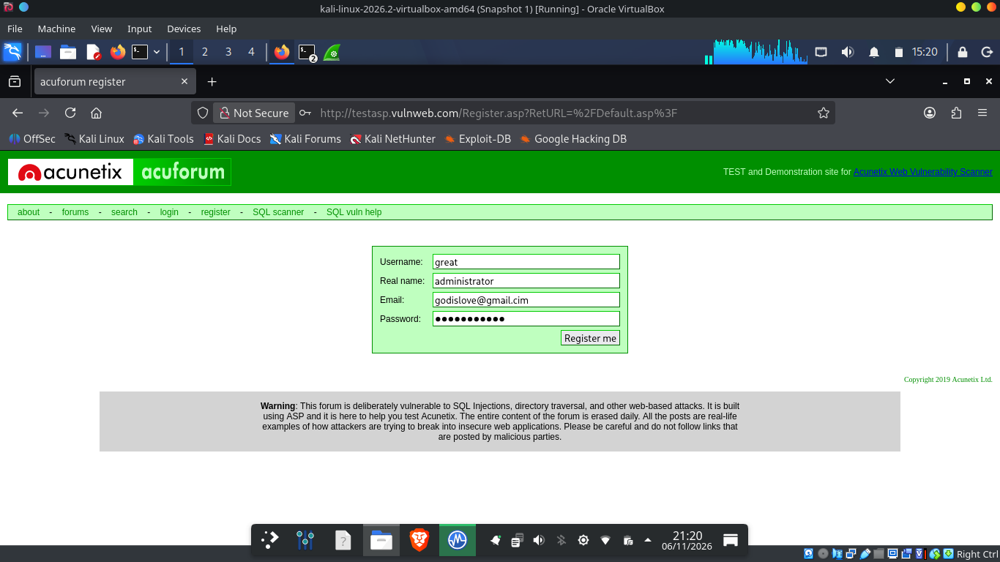
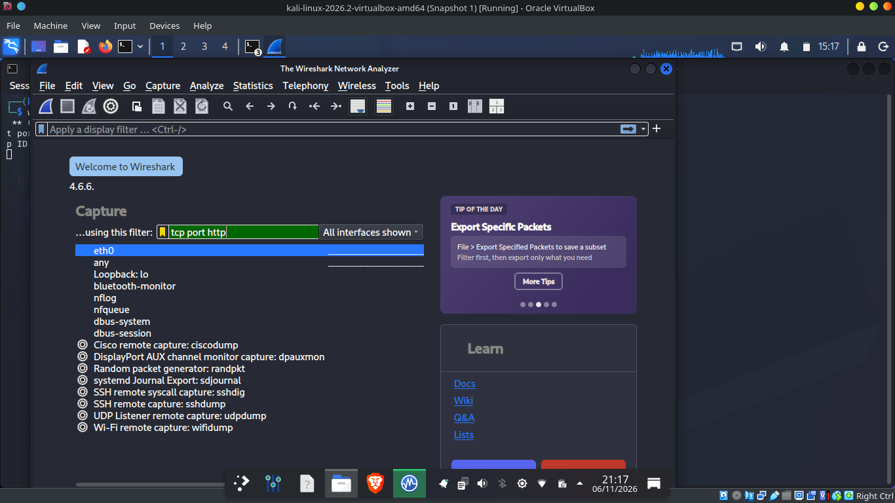
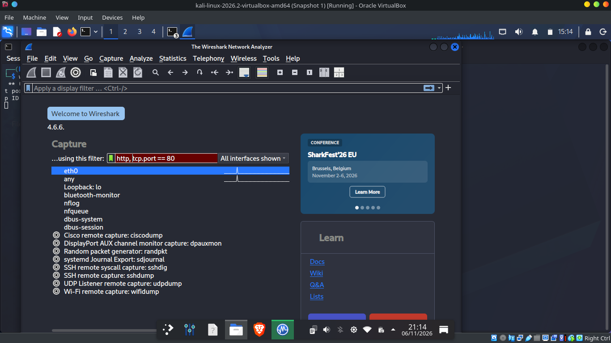
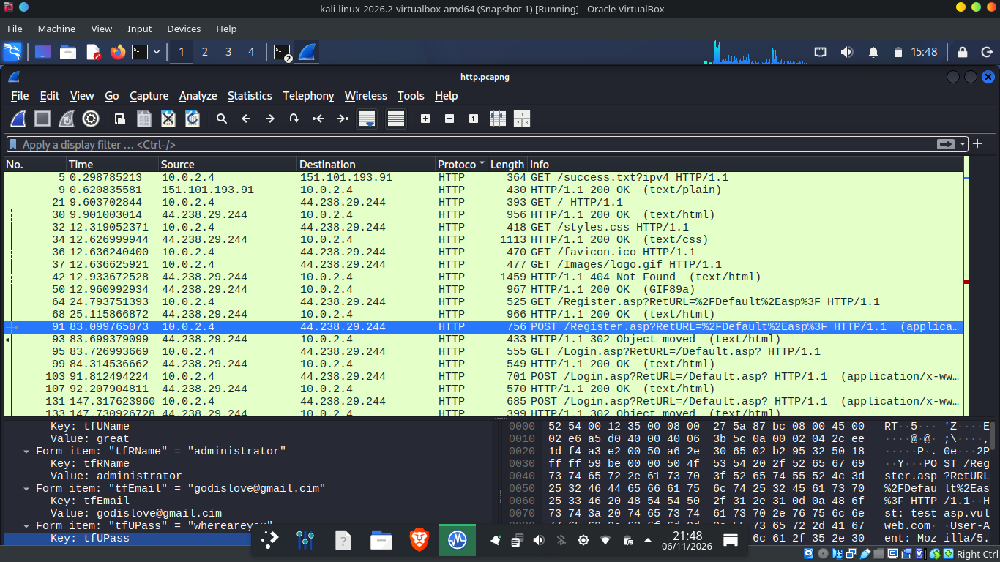
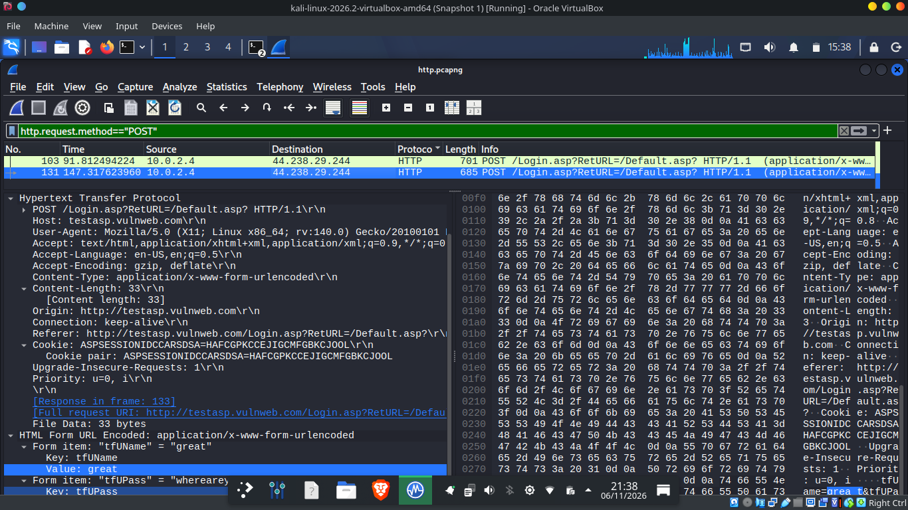
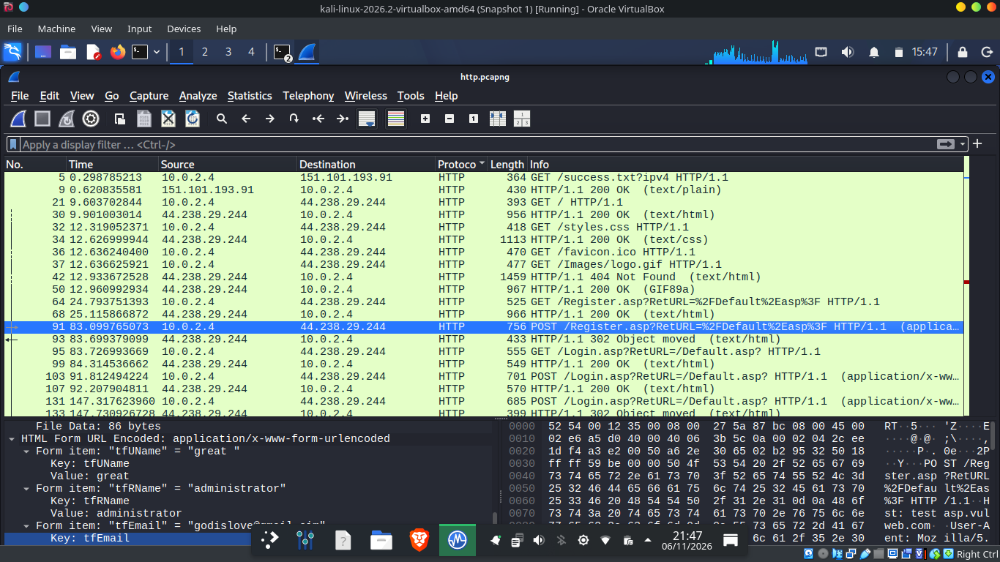
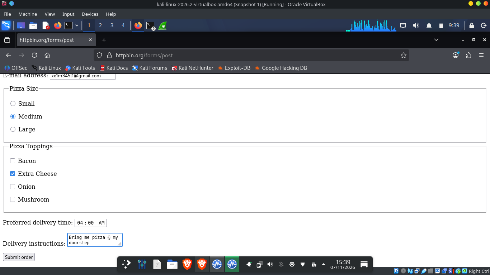
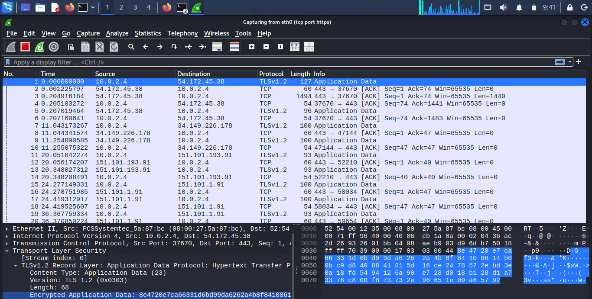
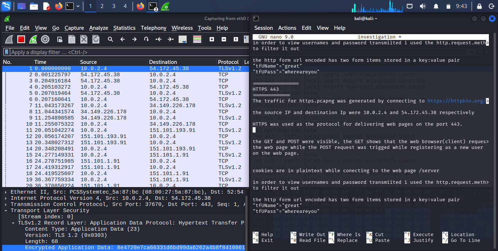

# soc_bootcamp_wk5_NSM

# HTTP vs HTTPS Traffic Analysis Lab

In this lab I captured web form submissions with Wireshark to see what someone on the same network can read over plain HTTP, and what HTTPS hides.

> **Note:** The credentials here belong to a test account on `testasp.vulnweb.com`, a site built on purpose for security practice. The password is redacted in the text.

## Environment

| Component | Details |
|---|---|
| Host OS | Kali Linux 2026.2  |
| Capture tool | Wireshark 4.6.6 |
| Source IP | `10.0.2.4` (Kali VM) |
| HTTP target | `http://testasp.vulnweb.com` (Acunetix Acuforum, ASP) |
| HTTP destination | `44.238.29.244`, port 80 |
| HTTPS target | `https://httpbin.org/forms/post` |
| HTTPS destination | `54.172.45.38`, port 443 |
| Capture files | `http.pcapng`, `https.pcapng` |

## 1. Registering on the HTTP Target

I registered a new user on the forum over plain HTTP.

*Registration form filled in with test values. Click the image to view it full size.*

## 2. Capture Setup

I started the capture on `eth0` with the filter `tcp port http`. My first try used `http, tcp.port == 80`, and Wireshark rejected it because of the stray comma.

*Capture filter `tcp port http` entered on the start screen with `eth0` selected.*

*The invalid filter `http, tcp.port == 80`. The red field shows the syntax error.*

## 3. Finding the POST Requests

The capture shows traffic from `10.0.2.4` to `44.238.29.244` on port 80. The `POST /Register.asp` request is frame 91 (756 bytes, at 83.099 s). The two `POST /Login.asp` requests are frame 103 (at 91.812 s) and frame 131 (at 147.317 s).

*Unfiltered packet list with frame 91 (`POST /Register.asp`) and frame 131 (`POST /Login.asp`) visible. The display filter bar is empty.*

To narrow it down, I used `http.request.method == "POST"`:

*With this filter only frames 103 and 131 (both logins) show up. Frame 91 is not in this view.*

## 4. Reading the Form Data

I expanded **HTML Form URL Encoded** in the packet details. Each field shows up as a key and value pair.

*Frame 91 has 86 bytes of form data. The username field reads `great ` with a trailing space, and the value is `great`.*

*The registration fields `tfUName`, `tfRName`, `tfEmail`, and `tfUPass` are all readable.*

*Frame 131 (685 bytes) shows `tfUName` and `tfUPass` in plain text. The Cookie header is in this packet too.*

The hex/ASCII pane shows the same body as plain text (`tfUName=great&tfUPass=********`). I redacted the password here.

**Findings (HTTP):**
- Usernames, real names, emails, and passwords can all be read in full.
- The Cookie header carries `ASPSESSIONIDCCARSDSA` in plain text.
- Anyone on the same network segment could capture these values without special access.

## 5. Traffic Over HTTPS

The second capture was made while submitting the pizza order form on `https://httpbin.org/forms/post`.

*The order: Medium size, Extra Cheese, 04:00 AM delivery, and delivery instructions.*

I filtered the capture with `tcp port https`. The packets go from `10.0.2.4` to `54.172.45.38` on port 443, and each one shows as a `TLSv1.2 Application Data` record.

*Packets with the `tcp port https` filter. The detail pane shows `Encrypted Application Data`.*

*Packet detail with source port 37670 and destination port 443. A notes window covers part of the hex pane, so the previous screenshot is the one to check for the payload.*

**Findings (HTTPS):**
- The destination is `54.172.45.38` on port 443. That is the IP my browser connected to. The capture doesn't show a DNS lookup, so I can't prove the hostname from it.
- I couldn't read form fields, cookies, or the POST body. Only the record headers show (TLS 1.2, Application Data, length).
- IPs, ports, timing, and packet sizes are still visible, so metadata leaks even with TLS.

## 6. Comparison

| Property | HTTP (port 80) | HTTPS (port 443) |
|---|---|---|
| Form field names visible | Yes | No |
| Form values (passwords, emails) visible | Yes | No |
| Cookies visible | Yes | No |
| Destination IP and port visible | Yes (`44.238.29.244:80`) | Yes (`54.172.45.38:443`) |
| Packet timing and size visible | Yes | Yes |

## Conclusions

1. Plain HTTP exposes credentials and personal data to anyone who can see the traffic.
2. HTTPS hides form contents and cookies. IPs and ports are still visible, but they don't reveal the form data.
3. Users should never send credentials over HTTP, and sites should enforce HTTPS with HSTS.

